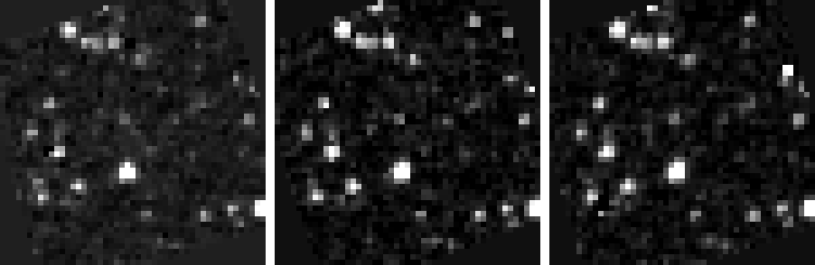

# نتائج الـ Spike: بيانات SPHEREx الحقيقية من IRSA

**التاريخ:** 2026-11-06 · **السكربت:** [`backend/scripts/spike_irsa_sia.py`](../backend/scripts/spike_irsa_sia.py)
**الهدف:** نعرف شكل البيانات الحقيقية قبل ما نكتب `RealSource`. هاد مش كود للـ API.

```bash
pip install astropy pyvo astroquery
python scripts/spike_irsa_sia.py --ra 133.79513 --dec -7.24514 --detector 3 --out spike_out/wise0855
```

---

## الخلاصة بسطرين
البيانات متاحة وسهلة الوصول، والـ cutouts شكلها ممتاز. بس في **3 مشاكل لازم نحلها بالباك إند**
عشان الـ blink يزبط: الصور **مدوّرة** بين الزيارات، والطول الموجي **مش ثابت** لنفس الـ detector،
والـ cutout **بطيء** (10–30 ثانية).

---

## 1. البحث (SIA2): ✅ شغّال

- الـ collections الموجودة: `spherex_qr2`, `spherex_qr2_deep`, `spherex_qr3`, `spherex_qr3_deep`.
- **QR3 مش نسخة أحدث من QR2، هو فترة زمنية تانية:** QR2 بيغطي تقريباً MJD 60790–61241
  (أيار 2025 → تموز 2026)، و QR3 بيبلّش من حوالي 61241. لازم **نبحث بالاتنين وندمج** عشان أطول baseline.
- الوقت: 1–14 ثانية لكل بحث (المناطق العميقة متل القطب الإكليبتيكي أبطأ). **بدنا cache.**
- ملاحظة: الـ radius لازم يكون أكبر من 0 (`1 arcsec` كفاية)، وإلا pyvo بيرفض.

| الهدف | QR2 | QR3 |
|---|---|---|
| WISE 0855-0714 | 256 صورة، 3 زيارات (60800 → 61174) | 0 |
| Barnard's Star | 241، زيارتين (60903 → 61165) | 123، زيارة (61269 → 61306) |
| Mira | 319، 3 زيارات (60871 → 61241) | 67، زيارة |
| WISE 0350-5658 | 482، 3 زيارات | 0 |

كل زيارة فيها عشرات الصور (6 detectors × عدة exposures على أيام).

### الحقول المهمة من SIA2 ← حقولنا بالعقد

| SIA2 | مثال | ← حقلنا |
|---|---|---|
| `obs_id` + `energy_bandpassname` | `2025W19_1B_0116_1` + `SPHEREx-D3` | `id` = `2025W19_1B_0116_1D3` (URL-safe ✅) |
| `t_min` / `t_max` | 60800.700 (MJD) | `mjd`, `obs_time` (أو `DATE-OBS` من الـ header) |
| `energy_bandpassname` | `SPHEREx-D3` | `band` = `D3` |
| `em_min` / `em_max` | بالمتر، للـ **detector كامل** | ❌ مش هو الطول الموجي عند الهدف |
| `access_url` | رابط FITS كامل (~70MB) | منستعمله للـ cutout |
| `s_region` | `POLYGON ICRS ...` | `footprint` (الحقيقي polygon مش دائرة) |
| `obs_collection` | `spherex_qr2` | `release` = `QR2` |
| `s_pixel_scale`, `s_fov` | 6.15″، 3.485° | يطابق افتراضاتنا ✅ |
| `cloud_access` | AWS bucket `nasa-irsa-spherex` | بديل أسرع محتمل (ما جرّبناه) |

## 2. الـ Cutout: ✅ شغّال، بس بطيء

- **الطريقة:** `access_url + ?center={ra},{dec}deg&size={N}arcsec`
- `size=300arcsec` ← صورة **49×49 بكسل** (6.15″)، بالزبط متل الـ mock.
- **الحجم 5.1MB** حتى لو الصورة صغيرة، لأنه معظمها extension الـ `PSF` (101×101×121).
- **الوقت 8–33 ثانية** لكل cutout. وصار معنا **503** مرة و**connect timeout** مرة، والمحاولة التانية نجحت.
- الـ HDUs: `IMAGE` (MJy/sr), `FLAGS`, `VARIANCE`, `ZODI`, `PSF`, `WCS-WAVE`.
- `ZODI` = تقدير الـ zodiacal light. **منطرحه** قبل الـ stretch.

## 3. ⚠️ المشكلة 1: الصور مدوّرة بين الزيارات

الـ cutout هو قطعة pixels بإطار الـ detector، **مش north-up**. قسنا زاوية الشمال:

| التاريخ | زاوية الشمال |
|---|---|
| 2025-05-05 | −163° |
| 2025-11-10 | **+20°** |
| 2026-04-21 | −165° |

يعني بين الزيارات الصورة **مقلوبة حوالي 180°**، والـ blink بدون تصحيح ما إله معنى.
**الحل (مجرّب بالـ spike ✅):** reprojection لشبكة north-up موحّدة حوالين (ra, dec)، باستعمال الـ WCS
وbilinear interpolation (numpy بس). بعدها النجوم بتطلع بنفس المكان بالتلات صور:



*(بيانات SPHEREx QR2 حقيقية، ZODI مطروح، asinh بنفس الـ limits. من الشمال لليمين: 2025-05، 2025-11، 2026-04.)*
**ملاحظة:** لازم نطلب cutout أكبر بـ ~1.45× (√2)، وإلا الزوايا بتطلع فاضية بعد التدوير.

## 4. ⚠️ المشكلة 2: نفس الـ detector ≠ نفس الطول الموجي

الـ spectral WCS شغّال ✅: `WCS(header, fobj=hdul, key="W")`، و`CTYPE = WAVE-TAB`، والوحدة µm.
بس الطول الموجي **عند الهدف** بيعتمد على وين وقع بالـ detector:

| التاريخ | Detector | λ عند المركز |
|---|---|---|
| 2025-05-05 | D3 | **2.365 µm** |
| 2025-11-10 | D3 | 1.623 µm |
| 2026-04-21 | D3 | 1.629 µm |

داخل الـ cutout الواحد (300″) التغيّر صغير (حوالي 0.016 µm)، فـ"λ عند المركز" تقريب منيح.
**يعني:** عشان مقارنة عادلة لازم نختار صور من زيارات مختلفة **بأقرب λ عند الهدف**، مش بس نفس الـ detector.
والمشكلة إنه λ ما بنعرفه إلا من الـ header تبع كل صورة.

**فكرة لازم نتحقق منها:** جدول `WCS-WAVE` ممكن يكون ثابت لكل detector. إذا هيك:
1. منجيب header الـ `IMAGE` بس، بـ HTTP Range على أول الملف.
2. منحسب بكسل الهدف من الـ WCS السماوي.
3. منقرأ λ من جدول محفوظ عندنا.

هيك بدون ما ننزّل 5MB لكل صورة.

## 5. ⚠️ المشكلة 3: الأداء

بحث (حتى 14 ثانية) + cutout (10–30 ثانية لكل صورة) × عدة زيارات = **دقيقة أو أكتر** لكل blink.
- **للديمو:** منعمل **prefetch** للأهداف المختارة مسبقاً، ومنحفظ الـ FITS والـ PNG على الديسك.
- **للبحث الحر:** cache، وطلبات بالتوازي (async)، و`connect timeout` قصير (~10s) مع retries،
  و`UPSTREAM_ERROR` واضح للفرونت. وبدنا loading state عند سديل.

## 6. ملاحظات تانية
- **WISE 0855 خافت جداً تحت ~3 µm.** الأقزام البنية الباردة لازم ننقّيلها D5/D6 (حوالي 4–5 µm).
  النقطة الساطعة بالـ cutouts عند 1.6 µm **مش أكيد إنها WISE 0855**، وما منعرضها هيك.
- astropy بيطلّع تحذير SIP (`CTYPE` بدون `-SIP` بس في معاملات SIP). مش واضح إذا لازم ننتبه. **سؤال ليزن.**
- **Windows:** astropy فشل يحمّل لما الـ venv كان بمسار طويل كتير
  (`DLL load failed ... filename or extension is too long`). خلّوا الـ repo أو الـ venv بمسار قصير.

## 7. التعديلات المقترحة على العقد (v0 ← v1)
1. `release` بييجي من `obs_collection` (`QR2` / `QR3`)، والبحث بيدمج الاتنين.
2. `footprint` ← polygon من `s_region` بدل الدائرة (أو منخليه دائرة تقريبية).
3. `/image`: north-up بعد reprojection، و**تأكيد بالعقد** إنه كل الأرصاد بنفس الـ ra/dec/size بتنعرض على نفس الشبكة.
4. `/search`: parameter اختياري `wavelength_um` و`tolerance_um` لاختيار صور بنفس الطول الموجي.
5. `/image`: ممكن ياخد 10–30 ثانية، والفرونت لازم يعرض loading. منضيف `504`/`UPSTREAM_ERROR` للـ timeout.

## 8. أسئلة جديدة ليزن
- هل جدول `WCS-WAVE` ثابت لكل detector عبر كل الصور؟ (إذا آه، الأداء بيتحسن كتير)
- شو الـ tolerance المقبول بالطول الموجي لمقارنة زيارتين؟
- منستعمل reprojection بسيط (bilinear) ولا `reproject` / drizzle أدق؟
- بنستعمل `FLAGS` لنخفي البكسلات السيئة؟
- تحذير SIP بالـ header، في مشكلة؟
